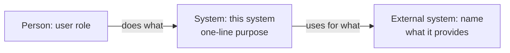
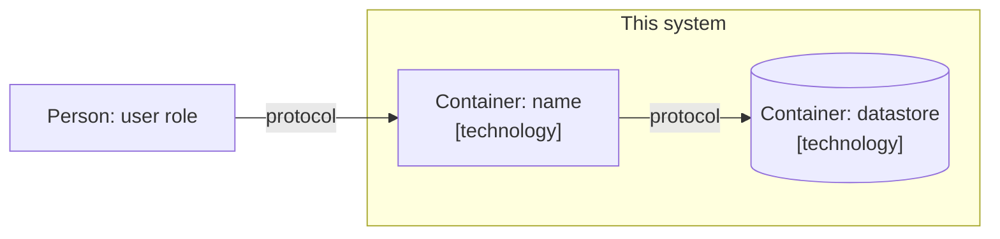

# Architecture overview

Uses the C4 model, levels 1 and 2 only. Add component or code diagrams only when complexity justifies it, and record why. Fill every section from the real code and configuration. Write `Unknown, verify` for anything not yet confirmed.

## Purpose and boundaries

- What problem does the system solve, and for whom?
- What is inside the system boundary?
- What is explicitly outside it?

## System context (C4 level 1)

Show the system, the people who use it and the external systems it talks to. Replace the example with the real ones.

## Containers (C4 level 2)

Show the separately deployable or runnable parts (applications, services, databases, queues) and how they communicate. Label each with its technology.

## Technology choices

List the main technologies actually in use and link the ADR that explains each non-obvious choice. Do not list technologies that are only planned.

## External dependencies

List each external system, library-level service or data source the system relies on: what it provides, how it is accessed, and what happens when it is unavailable.

## Constraints

List the constraints that shape the design: regulatory, performance, security, data residency, team or budget limits. State the source of each.
